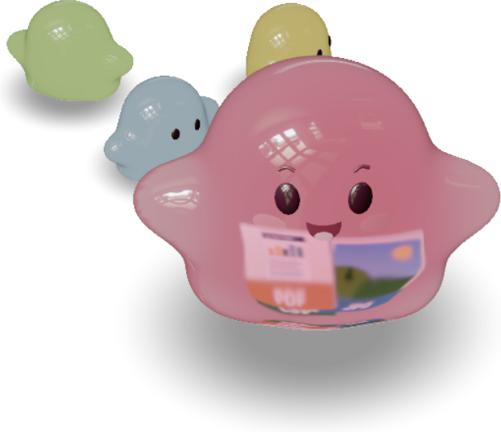
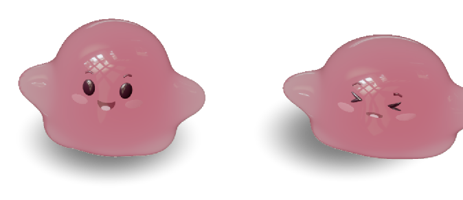
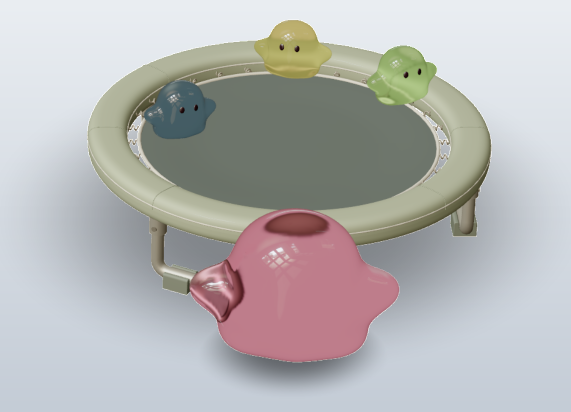
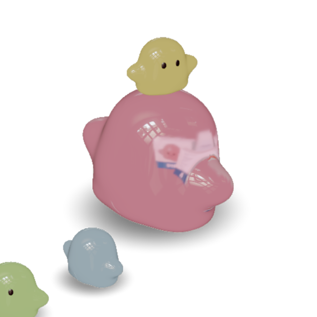
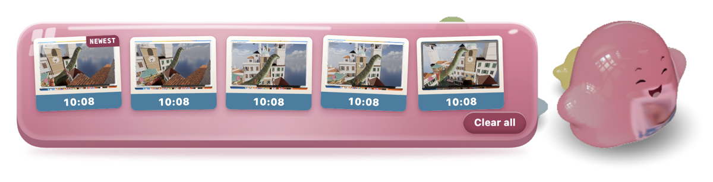
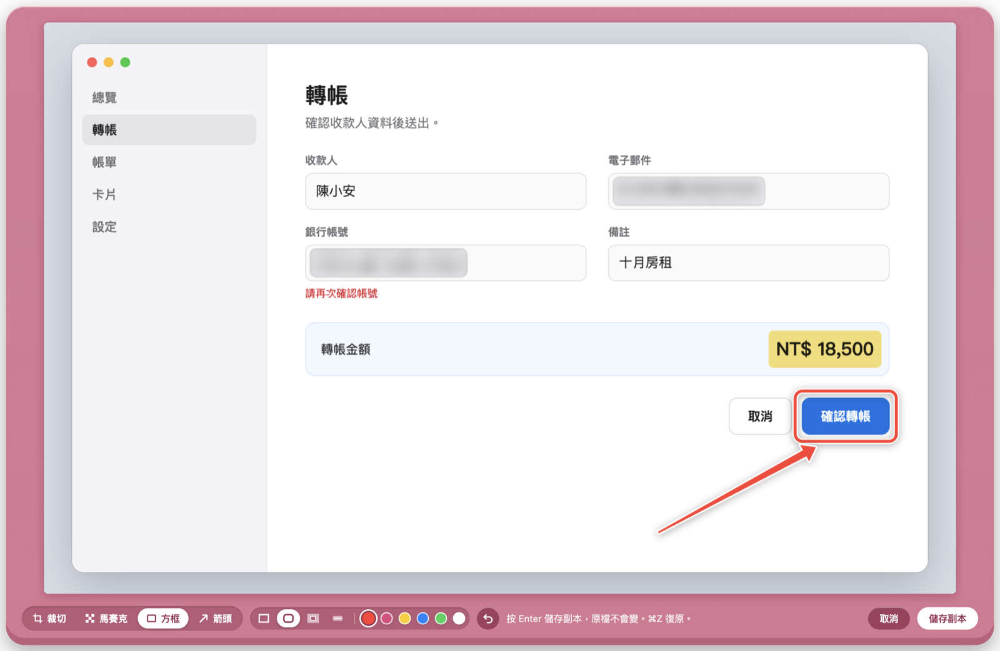

# Jelly

[English](README.en.md)

Jelly 是一隻住在 macOS 桌面上的軟果凍。她會在所有螢幕上走來走去，可以抓起來甩，戳她一下會皺起臉。她也幫你收檔案：新的截圖一存好就被她吞進肚子裡，雙擊她就能把截圖拖出來，丟進聊天視窗或 AI 應用程式。

<p align="center"></p>

她的身體、物理和外觀來自 scottstts 的 [Jelly Baby](https://github.com/scottstts/Jelly-Baby)，一個在瀏覽器裡玩的軟體物理小遊戲。這個專案把她搬到桌面上，加上檔案收納、截圖整理和三隻小果凍。

## 下載與安裝

1. 到 [Releases](https://github.com/catsmice/jelly-desktop-oss/releases) 下載最新的 `Jelly-<版本>-arm64.dmg`。
2. 打開 `.dmg`，把 Jelly 拖進「應用程式」資料夾。
3. 打開 Jelly。她會出現在桌面上，選單列也會多一個她的圖示。

App 經過 Apple 簽署與公證，第一次打開時不會出現「無法驗證開發者」的警告。

Jelly 只支援 Apple Silicon 的 Mac（M1 以後的機型）。開發和測試都在 macOS 27 上，較舊的 macOS 版本沒有測試過。

## 跟她玩

- 按住她可以拖著走，放手時順勢一甩，她會飛出去再落地。
- 點她一下，她會被戳得皺起臉。
- 在她身上用兩指捲動或捏合，可以放大或縮小她，大小會被記住。
- 雙擊她會打開收納盤。
- 按右鍵或點選單列的圖示，會打開她的選單。

三隻小果凍跟在她後面走。她自由走動時，偶爾會冒出一張彈跳床讓大家上去跳；小果凍無聊了，會爬到她頭上坐一會兒。

<p align="center">
  
  
  
</p>

## 把檔案交給她

把任何檔案拖到她身上，她就會吞下去，檔案變成卡片出現在她肚子裡。檔案本身不會被移動或複製，她只記得檔案放在哪裡。

雙擊她會打開收納盤，所有卡片攤開在她旁邊，最新的排在最前面。在收納盤裡可以：

- 把卡片拖到任何 App，例如 Finder、郵件或聊天視窗。
- 游標停在卡片上按空白鍵，用「快速查看」預覽。
- 按卡片上的垃圾桶。截圖和螢幕錄影會被丟進垃圾桶，之後還能「放回原處」；其他檔案她只是放下，檔案留在原來的位置。
- 按「全部清除」，放下所有卡片。

檔案也可以直接拖到收納盤上交給她。

<p align="center"></p>

## 截圖

Jelly 會看著 macOS 存放截圖的資料夾（沒改過的話是桌面），新的截圖一存好就收進肚子裡，卡片上標著拍攝時間。她最多拿著當天的 12 張。

在桌面這種共用的資料夾裡，她只收 macOS 標記為截圖的檔案，其他圖片都不碰，也不會搬動任何檔案。螢幕錄影沒有這個標記，所以只有在專門放截圖的資料夾裡才會收。

想讓截圖自動整理的話：

1. 右鍵選單 → 截圖 → 選擇資料夾…，選一個專門放截圖的資料夾，例如 `~/Pictures/Screenshots/Inbox`。
2. 她會問要不要讓 macOS 以後把截圖存到這裡，選「存到這裡」。
3. 勾選「依月份歸檔」。她會先跟你確認一次。之後被拖出去的截圖，還有不是當天拍的截圖，都會移到資料夾裡對應月份的子資料夾，例如 `2026-10/`。她不會刪除任何檔案。

家目錄、桌面、文件和下載項目這幾個資料夾，不能開啟依月份歸檔。

### 給 AI 應用程式用的 1× 截圖

Retina 螢幕的截圖，寬和高都是畫面上看到的兩倍。從收納盤拖出截圖時，Jelly 交出去的是縮成 1× 的副本，例如 3024×1964 會變成 1512×982。丟進 Claude 這類 AI 應用程式時，用掉的 token 大約少六成。原檔不會被改動。不需要的話，可以在 截圖 → 縮圖自動縮小成 1× 關掉。

### 編輯：裁切、馬賽克、方框和箭頭

任何圖片卡片都可以編輯，截圖、下載的圖片或你交給她的圖片都行。游標停在卡片上按 C，或按卡片上的編輯按鈕，就會打開編輯視窗。下方有四個工具：

- 裁切：拖出要保留的範圍，拖曳四個角調整。
- 馬賽克：在密碼、客戶名稱、帳號這類不想給人看的地方拖出一塊範圍，裡面的字會被打散。可以是方形色塊、毛玻璃或果凍方塊。
- 方框：圈出重點。有直角框、圓角框、聚光（框外的地方變暗）和螢光筆。
- 箭頭：從起點拖到要指的地方，有簡單、漸粗和弧形三種。

選了工具以後，旁邊會出現它的樣式，方框和箭頭還可以選顏色。她會記得你上次選的。

<p align="center"></p>

按 ⌘Z 復原上一步，按 Enter 儲存。編輯好的圖會存在原檔旁邊，檔名後面加上「(edited)」，並以新卡片回到她肚子裡。原檔不會被改動，所以打了馬賽克的內容在原檔裡還看得到，要分享的是新的那張。

## 下載項目

在選單勾選「偵測下載項目」後，下載完成的檔案會出現在她肚子裡，方便直接拖到別的地方。她只拿著最新的 8 個，檔案一直留在「下載項目」資料夾裡。這個功能預設關閉，第一次開啟時 macOS 會詢問是否允許存取「下載項目」。

## 不擋路

在你正在使用的螢幕上，她會待在原地，在小範圍裡動來動去，過一分鐘就打起瞌睡。接了好幾個螢幕的話，她可以在其他螢幕上到處走。鍵盤和滑鼠放著一分鐘沒動，她才會在所有螢幕上自由走動。

想讓她一直待在同一個位置，在右鍵選單選「固定在這裡」。固定之後拖動她，就是幫她換位置。

她擋到視窗的時候，在選單選「躲到邊邊」，她會走到螢幕最近的一側，只露出半個身體。再選一次，她就走回原本的位置。把她從邊邊拖出來也可以。

截圖和螢幕分享都拍不到她，拍整個螢幕時不用先把她移開。

## 選單

| 項目 | 作用 |
| --- | --- |
| 打開收納盤 | 只出現在選單列圖示的選單裡 |
| 固定在這裡 | 讓她一直待在現在的位置 |
| 躲到邊邊 | 讓她躲到螢幕側邊，只露出半個身體 |
| 偵測下載項目 | 接住下載完成的檔案 |
| 截圖 | 選擇資料夾、依月份歸檔、1× 縮圖 |
| 登入時開啟 | 登入 Mac 時自動打開 Jelly |
| 語言 | 自動、English 或繁體中文；自動會跟著系統語言 |
| 結束 Jelly | |

## 耗用的資源

她是即時運算的 3D 軟體物理模擬，記憶體大約用 1 GB。待在原地打瞌睡時，大約佔一個 CPU 核心的 18%，醒著走動時會更多。

## 隱私

Jelly 的程式不會連上網路，沒有帳號，也不收集任何資料。她只讀你交給她的檔案、截圖資料夾，以及開啟偵測時的下載項目。設定存在 `~/Library/Application Support/jelly-desktop/`，記錄檔在 `~/Library/Logs/jelly-desktop/jelly.log`。記錄檔裡有她收過的檔案名稱，只存在你的 Mac 上。

## 移除

如果開過「登入時開啟」，先在選單取消勾選。結束 Jelly，再把「應用程式」裡的 Jelly 丟到垃圾桶。要連設定一起清掉，再刪除上面那兩個資料夾。

## 從原始碼執行

```sh
git clone https://github.com/catsmice/jelly-desktop-oss.git
cd jelly-desktop-oss
npm install
npm start
```

`app/` 裡已經放了建置好的 Jelly Baby，所以不用另外建置就能執行。重新建置 `app/`、打包和發行的步驟寫在 [docs/DEVELOPMENT.md](docs/DEVELOPMENT.md)（英文）。

## 致謝與授權

- 果凍本體、軟體物理和外觀：scottstts 的 [Jelly Baby](https://github.com/scottstts/Jelly-Baby)，GPL-3.0 授權。
- 她身上反射的房間光線：Poly Haven 的 [Empty Play Room](https://polyhaven.com/a/empty_play_room)，由 Greg Zaal 拍攝、Jarod Guest 處理，CC0 授權。

Jelly desktop 以 GPL-3.0 授權發布，詳見 [LICENSE](LICENSE) 和 [NOTICE.md](NOTICE.md)。
